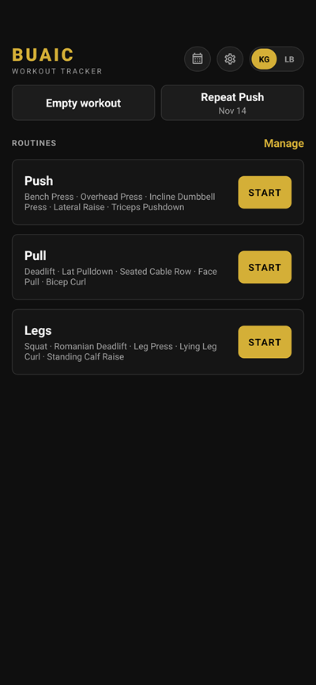
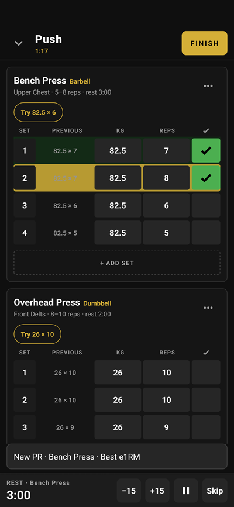
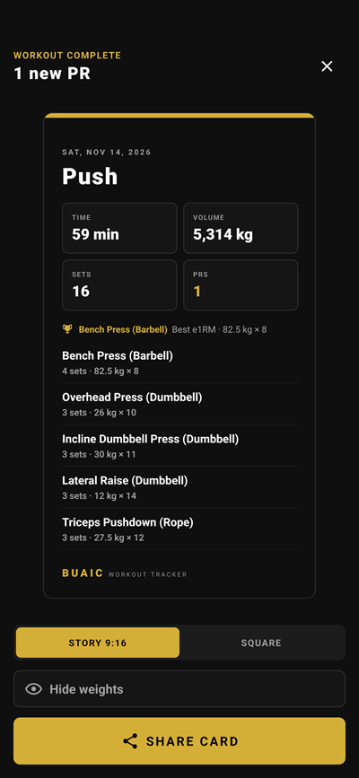
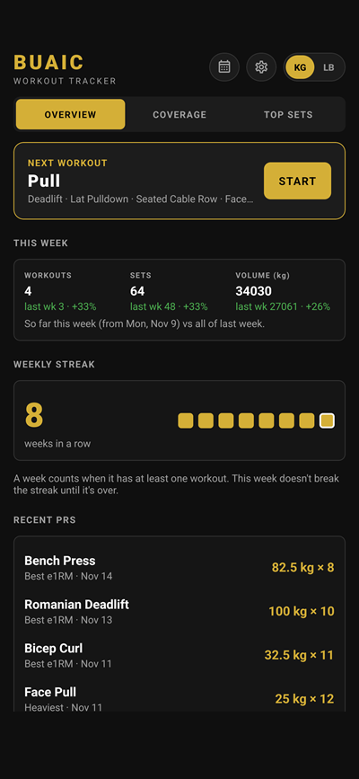
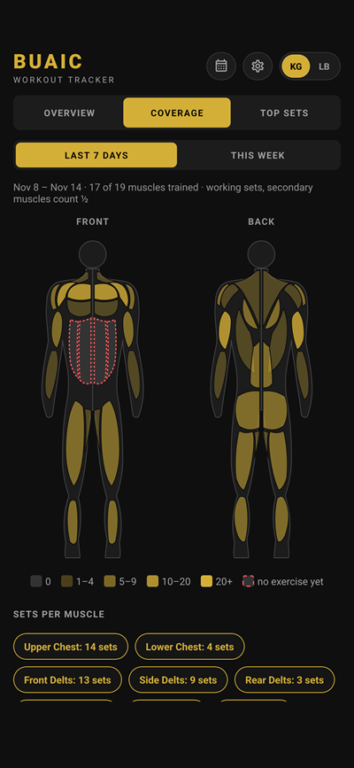
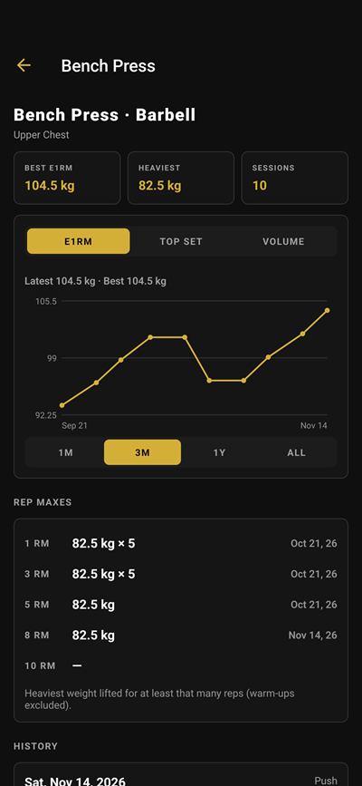
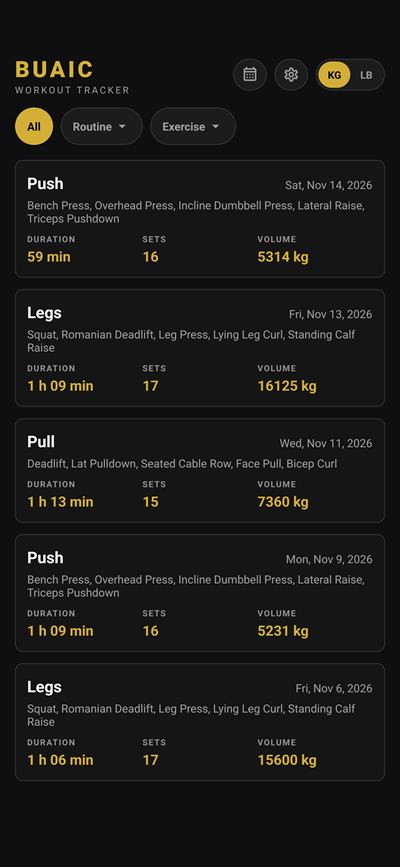
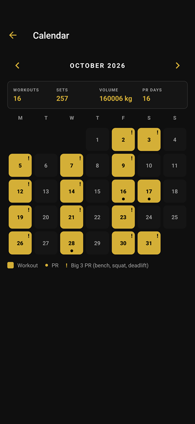

# Buaic: Workout Tracker

A free, offline-first workout tracker for iPhone and Android. No account, no ads, no tracking: your workouts are stored on your phone, and the app never sends them anywhere.

**[Download on the App Store](https://apps.apple.com/app/id6824904502)** (iPhone, iOS 16.4 or later). There's no Play Store listing; on Android, build it from source (see [Development](#development)).

Version 2.0 is a rebuild of 1.0: routines, a crash-safe workout log, real PRs, progress charts, a home-screen widget and more. Workouts logged in 1.0 come with you when you update.

<table>
  <tr>
    <td align="center"><br /><sub>Routines</sub></td>
    <td align="center"><br /><sub>Active workout and a new PR</sub></td>
    <td align="center"><br /><sub>Share card</sub></td>
    <td align="center"><br /><sub>Progress overview</sub></td>
  </tr>
  <tr>
    <td align="center"><br /><sub>Muscle coverage</sub></td>
    <td align="center"><br /><sub>Exercise progress</sub></td>
    <td align="center"><br /><sub>History</sub></td>
    <td align="center"><br /><sub>Calendar</sub></td>
  </tr>
</table>

<sub>Screenshots from the Android emulator with sample data.</sub>

## Features

**Workouts**
- Routines you build yourself, or start from Push/Pull/Legs, Upper/Lower or Full Body templates.
- Nothing gets lost: a workout is saved from the first tap, every ticked set at once and typed values within half a second, so it survives the app being closed or crashing.
- Set rows with the previous session's numbers, warm-up / working / drop / failure sets, optional RPE, swipe to delete with undo.
- Real PRs (heaviest, best estimated 1RM, 1/3/5/8/10-rep maxes) checked against your all-time bests, with a gold flash when you hit one.
- Progression hints, a plate calculator, and a rest timer with ±15 s, presets, pause and a notification when the phone is locked.
- An exercise library of 119 exercises across 19 muscle groups, plus your own: pick the main muscle on a body map and add secondary muscles.

**Progress**
- Dashboard: this week against last week, weekly streak, next workout and recent PRs.
- Exercise charts (estimated 1RM, top set, volume) and rep-max tables.
- Front and back body maps showing how much each muscle was trained this week (a secondary muscle counts as half a set).
- A calendar with workout days, PR marks (Big 3 lifts highlighted) and monthly totals.
- Editable history: fix a weight, the reps or the date of a past workout, and PRs follow.

**Everything else**
- Home-screen widget (iPhone and Android): your week at a glance and one tap to start the next routine.
- iPhone: the rest countdown on the Lock Screen and in the Dynamic Island (Live Activity).
- Share card: a story or square image of a workout, with an option to hide the weights.
- Backup and restore as a JSON file, and CSV export of every set for spreadsheets.
- kg or lb, week starting Monday or Sunday, onboarding for new users, haptics, Reduce Motion, large text and screen reader support.

## Privacy

- No account, no ads, no analytics, no tracking. App Store privacy label: **Data Not Collected**.
- Your data is in a SQLite database on your phone. Buaic doesn't send it anywhere.
- Backups and CSV exports are files you create yourself and share or save where you choose.
- Rest notifications are local to the phone. The widget and the Live Activity are updated on the device by the app.

Full policy: [PRIVACY.md](PRIVACY.md).

## Upgrading from 1.0

Updating installs over 1.0 and keeps your data. On first launch Buaic 2.0 copies the 1.0 database to `iron_and_stone.v1-backup.db` (next to the database, never overwritten), checks the copy, and then migrates in a single transaction: each 1.0 split becomes a routine with the same exercises in the same order, and History, top sets and the calendar show the same workouts. If the migration ever fails, the app opens to a "Your data is safe" screen with Retry and Share backup file, and nothing is changed.

Once updated, stay on 2.0: version 1.0 can't read the migrated database.

## Tech stack

- [Expo](https://expo.dev) SDK 58, React Native 0.88 (New Architecture)
- TypeScript in strict mode
- Expo Router with native tabs
- `expo-sqlite` with versioned, tested migrations
- `expo-widgets` and `@expo/ui` for the home-screen widget and the iOS Live Activity
- `react-native-svg` for the charts and body maps (no chart library)
- Jest; the database code runs in tests on Node's built-in `node:sqlite` with the same SQL as the app

## Project layout

```
app/        Expo Router routes: the four tabs, workout, settings, calendar, detail screens
features/   Screens and UI by feature: workout, rest timer, routines, library, progress,
            history, backup, share card, widgets, onboarding, settings
lib/        Pure, tested logic: units, dates, e1RM, PRs, progression, plates, stats, CSV
db/         Schema, migrations, queries, seeding and JSON backup (expo-sqlite adapter)
theme/      Design tokens (colours, spacing, type), with a contrast test
plugins/    Config plugins: widget deep link, widget privacy manifest, short CMake paths on Windows
assets/     App icon, splash and the rest-timer chime
```

## Development

Developed on Node.js 24. The tests use Node's built-in `node:sqlite` (Node 22.13 or later).

```bash
npm ci
npm test              # Jest
npx tsc --noEmit      # type check
npx expo-doctor       # dependency and config check
```

Buaic uses native modules (widgets, SQLite, notifications), so it runs in a development build, not Expo Go: `npx expo run:android` builds and installs one, then `npx expo start --dev-client` serves the JavaScript.

**Android.** Generate the native project and build an APK:

```bash
npx expo prebuild --platform android
cd android
./gradlew assembleRelease -PreactNativeArchitectures=arm64-v8a "-Dorg.gradle.jvmargs=-Xmx4096m -XX:MaxMetaspaceSize=1536m"
```

The APK is in `android/app/build/outputs/apk/release/`. Gradle needs the larger JVM memory since the widget was added. On Windows, build from a short path (for example `C:\buaic-build`): the native build fails on long paths. Add `x86_64` to the architectures to run the APK on an emulator. An APK installs over an existing Buaic only if it's signed with the same key, so a build signed with your own key needs a fresh install.

**iOS.** Built and submitted with [EAS](https://docs.expo.dev/eas/) (`eas build --platform ios --profile production`, then `eas submit`); `eas.json` holds the profiles. Building iOS locally needs a Mac.

## License

MIT. See [LICENSE](LICENSE).
